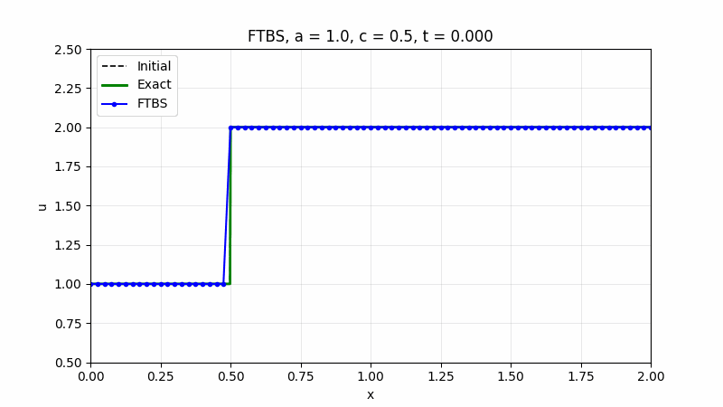

# FTBS Linear Convection

Teaching material for a CFD course: the 1D linear convection equation solved with the
forward-in-time, backward-in-space (FTBS, first-order upwind) scheme.



## The equation

```math
\frac{\partial u}{\partial t} + a \frac{\partial u}{\partial x} = 0, \qquad a = 1
```

The exact solution is the initial profile shifted to the right: $`u(x,t) = u_0(x - at)`$.

## The scheme

With the CFL (Courant) number

```math
c = \frac{a \Delta t}{\Delta x}
```

the FTBS update is

```math
u_i^{n+1} = u_i^n - c\left(u_i^n - u_{i-1}^n\right) = (1-c) u_i^n + c u_{i-1}^n
```

It is stable for $`a > 0`$ when $`0 \le c \le 1`$.

| CFL number | What you see |
|---|---|
| $`c < 1`$ | Stable, but the sharp front smears into a ramp (numerical diffusion). Smaller $`c`$ smears more. |
| $`c = 1`$ | $`u_i^{n+1} = u_{i-1}^n`$: an exact one-cell shift, zero error. |
| $`c > 1`$ | Unstable. The weight $`1 - c`$ is negative and oscillations grow until the solution blows up. |

The default initial condition is a shock-like step: $`u = 1`$ for $`x < 0.5`$ and $`u = 2`$ for $`x \ge 0.5`$,
on the domain $`x \in [0, 2]`$.

## Interactive animation

**Open it here: https://computationalgasdynamicslab.github.io/ME464/**

It runs in any web browser, with nothing to install. You can play the solution step by step,
change the CFL number and grid size, switch the initial condition, and see on a stencil diagram
why the scheme needs $`c \le 1`$.

## Run the Python script on your own computer

You only need this if you want to run or modify the Python code. The interactive page above
works in a browser without installing anything.

### Step 1: Install Python (one time)

You need Python 3.9 or newer. To check whether you already have it, open a terminal
(see below) and type `python3 --version` (macOS/Linux) or `py --version` (Windows).

- **Windows:** download the installer from https://www.python.org/downloads/ and run it.
  On the first screen, **check the box "Add python.exe to PATH"** before clicking Install.
- **macOS:** download the installer from https://www.python.org/downloads/ and run it.
  (If you use Homebrew, `brew install python` also works.)
- **Linux:** Python 3 is usually already installed. On Ubuntu/Debian, also run
  `sudo apt install python3-venv python3-pip`.

**How to open a terminal**
- Windows: press the Windows key, type `PowerShell`, and open **Windows PowerShell**.
- macOS: press Cmd + Space, type `Terminal`, and press Enter.
- Linux: press Ctrl + Alt + T.

### Step 2: Download the code

Pick one:

- **Without Git (easiest):** on this repository's GitHub page, click the green **Code** button,
  then **Download ZIP**. Unzip it, for example into your Documents folder. The folder will be
  called `ME464-main`.
- **With Git:**
  ```bash
  git clone https://github.com/ComputationalGasDynamicsLab/ME464.git
  ```

Then move the terminal into that folder, for example:

```bash
cd Documents/ME464-main     # use the folder name and location you actually have
```

Tip: type `cd ` (with a space) and then drag the folder from your file browser into the
terminal window; it fills in the path for you.

### Step 3: Create a virtual environment and install the packages (one time)

A virtual environment keeps this course's packages separate from the rest of your computer.

**Windows (PowerShell):**
```powershell
py -m venv .venv
.venv\Scripts\Activate.ps1
pip install -r requirements.txt
```

**macOS / Linux:**
```bash
python3 -m venv .venv
source .venv/bin/activate
pip install -r requirements.txt
```

When the environment is active, your prompt starts with `(.venv)`.

### Step 4: Run the solver

```bash
python ftbs_convection.py                # c = 0.5, step initial condition
python ftbs_convection.py --cfl 1.0      # exact shift
python ftbs_convection.py --cfl 1.1      # unstable
python ftbs_convection.py --animate      # also saves an animated GIF
python ftbs_convection.py --help         # all options
```

Each run prints the grid spacing, time step and maximum error, and saves the plot
`ftbs_convection.png` (and `ftbs_convection.gif` with `--animate`) in the same folder.
Open those files to see the results.

Options you can combine:

| Option | Meaning | Default |
|---|---|---|
| `--cfl` | CFL number $`c = a \Delta t / \Delta x`$ | 0.5 |
| `--nx` | number of grid points | 81 |
| `--t-end` | final time | 1.0 |
| `--shape` | initial condition: `step`, `square` or `gauss` | `step` |
| `--a` | wave speed | 1.0 |
| `--animate` | also save `ftbs_convection.gif` | off |

Example: `python ftbs_convection.py --cfl 0.25 --nx 161 --shape square --animate`

### Next time

The installation is one time only. Next time, open a terminal, `cd` into the folder,
activate the environment (`.venv\Scripts\Activate.ps1` on Windows,
`source .venv/bin/activate` on macOS/Linux) and run the script.

### Troubleshooting

| Problem | Fix |
|---|---|
| `python` or `py` is "not recognized" / "command not found" | Python is not installed or not on PATH. On Windows, rerun the installer, choose **Modify**, and enable **Add Python to environment variables**. On macOS/Linux use `python3` instead of `python` before the environment is activated. |
| Windows: "running scripts is disabled on this system" when activating | Run `Set-ExecutionPolicy -Scope CurrentUser RemoteSigned` once in PowerShell, answer `Y`, then activate again. Or use Command Prompt and run `.venv\Scripts\activate.bat`. |
| `ModuleNotFoundError: No module named 'numpy'` (or `matplotlib`) | The environment is not active, or Step 3 was skipped. Activate it and run `pip install -r requirements.txt`. |
| `No such file or directory: 'ftbs_convection.py'` / `requirements.txt` | The terminal is not inside the code folder. Use `cd` to go to the folder that contains these files (`dir` on Windows or `ls` on macOS/Linux lists them). |
| Linux: `ensurepip is not available` | Run `sudo apt install python3-venv` and repeat Step 3. |
| You use Anaconda | Skip the virtual environment. Open **Anaconda Prompt**, `cd` into the folder and run `python ftbs_convection.py`; numpy and matplotlib are already included. |
| pip prints "WARNING: You are using pip version …; you should consider upgrading" | Safe to ignore. Optionally run `python -m pip install --upgrade pip`. |
