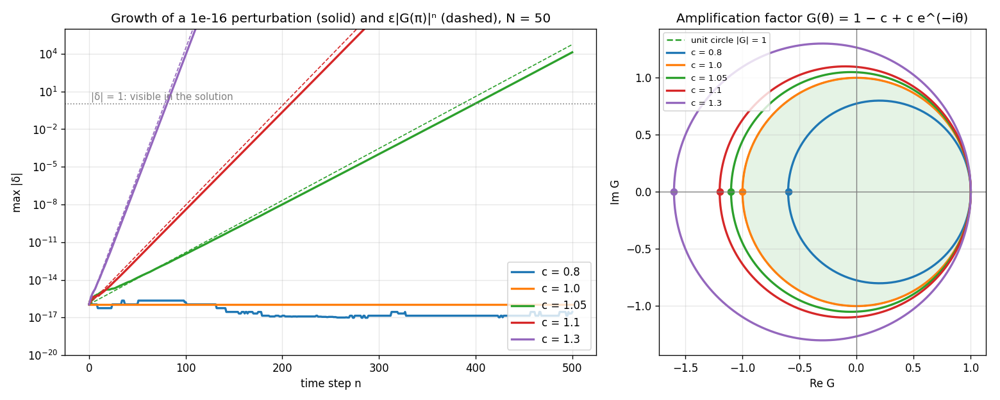

# FTBS Stability: Von Neumann Analysis and Round-off Growth

Teaching material for a CFD course: why the FTBS scheme for 1D linear convection needs
$`0 \le c \le 1`$, shown by following a tiny perturbation (the size of round-off error) as it is
damped or amplified. Companion to the [linear convection lab](../ftbs-linear-convection/).



## Interactive page

**Open it here: https://computationalgasdynamicslab.github.io/ME464/ftbs-stability/**

It runs in any web browser, with nothing to install. Two runs of FTBS start from the same smooth
profile on a periodic grid; one gets a perturbation $`\varepsilon`$ (default $`10^{-16}`$). The page shows:

- the perturbed solution, and the size of the perturbation $`|\delta_i|`$ at every point on a log scale
- the growth history $`\max|\delta|`$ against the time step, with the prediction $`\varepsilon |G|^n`$
- the amplification factor $`G(\theta)`$ as a circle in the complex plane, and $`|G|`$ against $`\theta`$
- the measured growth per step next to the predicted $`|G|`$, and how many steps the
  perturbation needs to reach size 1

You can change the CFL number, choose random noise or a single Fourier mode $`\theta = 2\pi k/N`$,
set $`\varepsilon`$ from $`10^{-16}`$ to $`10^{-4}`$, and change the number of grid points.

## Von Neumann analysis

The FTBS scheme

```math
u_i^{n+1} = u_i^n - c\left(u_i^n - u_{i-1}^n\right), \qquad c = \frac{a\,\Delta t}{\Delta x}
```

is linear, so an error $`\delta`$ obeys the same update. Write it as a sum of Fourier modes and
follow one of them, $`\delta_j^n = G^n e^{ij\theta}`$, where $`\theta = k\,\Delta x`$ runs from 0 (long waves)
to $`\pi`$ (the sawtooth +, −, +, − at neighboring points). Substituting and dividing by
$`G^n e^{ij\theta}`$ gives the amplification factor

```math
G(\theta) = 1 - c + c\,e^{-i\theta}, \qquad |G|^2 = 1 - 2c(1 - c)(1 - \cos\theta)
```

Every step multiplies the mode by $`G`$. The scheme is stable if $`|G| \le 1`$ for every
$`\theta`$. Since $`1 - \cos\theta \ge 0`$, this holds exactly when $`c(1 - c) \ge 0`$:

```math
0 \le c \le 1
```

Geometrically, $`G(\theta)`$ traces a circle with center $`1 - c`$ and radius $`c`$. It touches the unit
circle at $`G(0) = 1`$ and reaches furthest left at $`G(\pi) = 1 - 2c`$. It stays inside the unit
circle exactly when $`0 \le c \le 1`$.

## Round-off error

Every floating-point operation has a relative error of about $`10^{-16}`$ in double precision.
These errors contain all wavelengths, including the sawtooth. So:

- for $`c \le 1`$, round-off stays at round-off level forever;
- for $`c > 1`$, its sawtooth part grows like $`10^{-16} \cdot |1 - 2c|^n`$ until it swamps the solution.

Starting from $`\varepsilon`$, the perturbation reaches size 1 after about

```math
n \approx \frac{\ln(1/\varepsilon)}{\ln|1 - 2c|}
```

steps. **An instability can hide:** a short run can look perfectly fine.

Results with $`N = 50`$ points and $`\varepsilon = 10^{-16}`$:

| $`c`$ | $`\lvert G(\pi) \rvert = \lvert 1 - 2c \rvert`$ | measured growth per step | steps until $`\lvert\delta\rvert = 1`$ (predicted) |
|---|---|---|---|
| 0.8 | 0.6 | 1.000 (stays at round-off level) | never |
| 1.0 | 1.0 | 1.000 | never |
| 1.05 | 1.1 | 1.099 | 399 (387) |
| 1.1 | 1.2 | 1.197 | 209 (202) |
| 1.3 | 1.6 | 1.591 | 81 (78) |

In the [convection lab](../ftbs-linear-convection/) the same instability appears within a few
dozen steps, because the step in the initial condition already contains short waves of size 1:
there is no $`10^{-16}`$ head start to overcome.

## Run the Python script on your own computer

You only need this if you want to run or modify the Python code. The interactive page above
works in a browser without installing anything.

### Step 1: Install Python (one time)

You need Python 3.9 or newer. To check whether you already have it, open a terminal
(see below) and type `python3 --version` (macOS/Linux) or `py --version` (Windows).

- **Windows:** download the installer from https://www.python.org/downloads/ and run it.
  On the first screen, **check the box "Add python.exe to PATH"** before clicking Install.
- **macOS:** download the installer from https://www.python.org/downloads/ and run it.
  (If you use Homebrew, `brew install python` also works.)
- **Linux:** Python 3 is usually already installed. On Ubuntu/Debian, also run
  `sudo apt install python3-venv python3-pip`.

**How to open a terminal**
- Windows: press the Windows key, type `PowerShell`, and open **Windows PowerShell**.
- macOS: press Cmd + Space, type `Terminal`, and press Enter.
- Linux: press Ctrl + Alt + T.

### Step 2: Download the code

Pick one:

- **Without Git (easiest):** on the [ME464 repository page](https://github.com/ComputationalGasDynamicsLab/ME464),
  click the green **Code** button, then **Download ZIP**. Unzip it, for example into your
  Documents folder. The folder will be called `ME464-main`, and this example is in its
  `ftbs-stability` subfolder.
- **With Git:**
  ```bash
  git clone https://github.com/ComputationalGasDynamicsLab/ME464.git
  ```

Then move the terminal into this example's folder, for example:

```bash
cd Documents/ME464-main/ftbs-stability    # ZIP download
cd ME464/ftbs-stability                   # git clone
```

Use the location you actually have. All commands below are run from this folder.

Tip: type `cd ` (with a space) and then drag the folder from your file browser into the
terminal window; it fills in the path for you.

### Step 3: Create a virtual environment and install the packages (one time)

A virtual environment keeps this course's packages separate from the rest of your computer.

**Windows (PowerShell):**
```powershell
py -m venv .venv
.venv\Scripts\Activate.ps1
pip install -r requirements.txt
```

**macOS / Linux:**
```bash
python3 -m venv .venv
source .venv/bin/activate
pip install -r requirements.txt
```

When the environment is active, your prompt starts with `(.venv)`.

### Step 4: Run the script

```bash
python ftbs_stability.py                       # c = 0.8, 1.0, 1.05, 1.1 and 1.3
python ftbs_stability.py --cfl 0.95 1.02 1.2   # your own CFL numbers
python ftbs_stability.py --eps 1e-8            # a larger initial perturbation
python ftbs_stability.py --help                # all options
```

It prints, for each CFL number, $`|G(\pi)|`$, the measured growth factor per step and the step at
which the perturbation reaches size 1, and saves the figure `ftbs_stability.png` in the same folder.

| Option | Meaning | Default |
|---|---|---|
| `--cfl` | one or more CFL numbers | 0.8 1.0 1.05 1.1 1.3 |
| `--nx` | number of grid points (periodic) | 50 |
| `--eps` | size of the initial perturbation | 1e-16 |
| `--steps` | maximum number of time steps | 500 |

### Next time

The installation is one time only. Next time, open a terminal, `cd` into the folder,
activate the environment (`.venv\Scripts\Activate.ps1` on Windows,
`source .venv/bin/activate` on macOS/Linux) and run the script.

### Troubleshooting

| Problem | Fix |
|---|---|
| `python` or `py` is "not recognized" / "command not found" | Python is not installed or not on PATH. On Windows, rerun the installer, choose **Modify**, and enable **Add Python to environment variables**. On macOS/Linux use `python3` instead of `python` before the environment is activated. |
| Windows: "running scripts is disabled on this system" when activating | Run `Set-ExecutionPolicy -Scope CurrentUser RemoteSigned` once in PowerShell, answer `Y`, then activate again. Or use Command Prompt and run `.venv\Scripts\activate.bat`. |
| `ModuleNotFoundError: No module named 'numpy'` (or `matplotlib`) | The environment is not active, or Step 3 was skipped. Activate it and run `pip install -r requirements.txt`. |
| `No such file or directory: 'ftbs_stability.py'` / `requirements.txt` | The terminal is not inside the code folder. Use `cd` to go to the folder that contains these files (`dir` on Windows or `ls` on macOS/Linux lists them). |
| Linux: `ensurepip is not available` | Run `sudo apt install python3-venv` and repeat Step 3. |
| You use Anaconda | Skip the virtual environment. Open **Anaconda Prompt**, `cd` into the folder and run `python ftbs_stability.py`; numpy and matplotlib are already included. |
| pip prints "WARNING: You are using pip version …; you should consider upgrading" | Safe to ignore. Optionally run `python -m pip install --upgrade pip`. |
