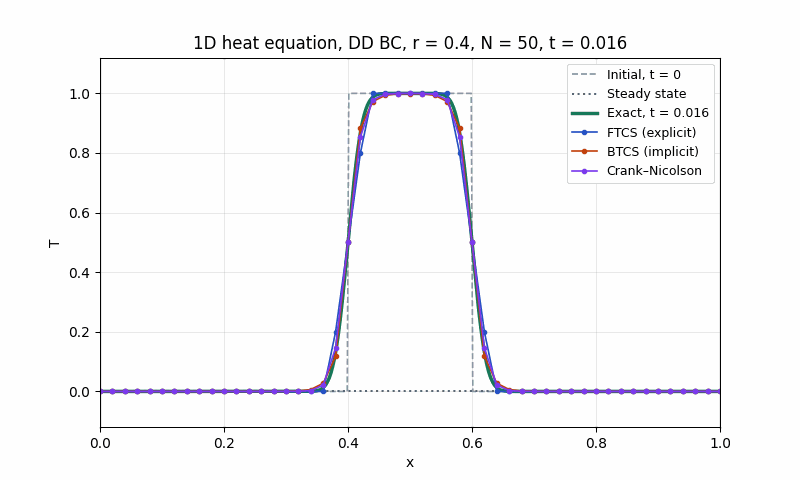

# 1D Unsteady Heat Equation: Explicit vs Implicit Time Stepping

Teaching material for a CFD course: the 1D unsteady heat equation solved with the explicit FTCS
scheme and the implicit BTCS and Crank–Nicolson schemes, compared with the exact solution.



## Interactive page

**Open it here: https://computationalgasdynamicslab.github.io/ME464/heat-equation/**

It runs in any web browser, with nothing to install. You can:

- play the solution, or step through it one time step at a time
- show FTCS, BTCS and Crank–Nicolson together; all three use the same $`\Delta x`$ and $`\Delta t`$
- type any diffusion number $`r`$ (0.01 to 50) and number of intervals $`N`$ (4 to 1000, so $`\Delta x`$ down to 0.001), or pick a
  preset: $`r = 1/6`$ (most accurate FTCS), 0.4 (as in the course report), 0.5 (stability limit),
  0.52 and 0.6 (FTCS unstable), 5 (implicit schemes only)
- choose the initial condition: $`\sin(\pi x)`$, two sine modes, or a square pulse
- read the maximum error of each scheme against the exact solution, and zoom in to see it
- see the amplification factor $`G(\theta)`$ of each scheme against the exact decay, and the
  explicit and implicit stencils

## The problem

```math
\frac{\partial T}{\partial t} = \alpha \frac{\partial^2 T}{\partial x^2}, \qquad 0 < x < L, \quad t > 0
```

with $`L = 1`$, $`\alpha = 0.01`$, $`T(0,t) = T(L,t) = 0`$ and $`T(x,0) = \sin(\pi x / L)`$. The exact solution is

```math
T(x,t) = \sin\left(\frac{\pi x}{L}\right) e^{-\alpha \pi^2 t / L^2}
```

For the other initial conditions each sine mode $`\sin(k\pi x/L)`$ decays like $`e^{-\alpha k^2\pi^2 t/L^2}`$:
short waves die much faster than long ones. The square pulse uses its Fourier sine series.

The grid is $`x_i = i\Delta x`$ with $`\Delta x = L/N`$, and all schemes use the diffusion number

```math
r = \frac{\alpha \Delta t}{\Delta x^2}
```

## Scheme 1: FTCS (explicit)

```math
T_i^{n+1} = T_i^n + r\left(T_{i+1}^n - 2T_i^n + T_{i-1}^n\right) = r T_{i-1}^n + (1 - 2r) T_i^n + r T_{i+1}^n
```

Each new value comes directly from known values. The error is $`O(\Delta t) + O(\Delta x^2)`$. The modified equation is

```math
T_t = \alpha T_{xx} + \frac{\alpha \Delta x^2}{12}(1 - 6r) T_{xxxx} + \dots
```

so at $`r = 1/6`$ the leading error cancels and FTCS becomes fourth order in $`\Delta x`$.

## Scheme 2: BTCS (fully implicit)

```math
-r T_{i-1}^{n+1} + (1 + 2r) T_i^{n+1} - r T_{i+1}^{n+1} = T_i^n
```

The unknowns at $`n+1`$ are coupled, so each step solves a tridiagonal system with the Thomas
algorithm. The error is still $`O(\Delta t) + O(\Delta x^2)`$.

## Scheme 3: Crank–Nicolson

```math
-\frac{r}{2} T_{i-1}^{n+1} + (1 + r) T_i^{n+1} - \frac{r}{2} T_{i+1}^{n+1} = \frac{r}{2} T_{i-1}^n + (1 - r) T_i^n + \frac{r}{2} T_{i+1}^n
```

The average of FTCS and BTCS, with error $`O(\Delta t^2) + O(\Delta x^2)`$.

## Stability

Put a Fourier mode $`T_j^n = G^n e^{ij\theta}`$, with $`\theta = k\Delta x`$, into each scheme. With
$`s = \sin^2(\theta/2)`$ the amplification factors are

```math
G_{FTCS} = 1 - 4rs, \qquad G_{BTCS} = \frac{1}{1 + 4rs}, \qquad G_{CN} = \frac{1 - 2rs}{1 + 2rs}
```

and the exact decay per step is $`e^{-r\theta^2}`$. Stability needs $`|G| \le 1`$ for every $`\theta`$.

- **FTCS** is stable only for $`r \le 1/2`$. For $`r > 1/2`$ the sawtooth ($`\theta = \pi`$) has
  $`G = 1 - 4r < -1`$, so round-off grows into a sawtooth that flips sign every step. At $`r = 0.6`$,
  $`N = 50`$ it blows up after about 150 steps.
- **BTCS** has $`0 < G \le 1`$ for every $`r`$: unconditionally stable and never oscillates.
- **Crank–Nicolson** has $`|G| \le 1`$ for every $`r`$, but $`G \to -1`$ for short waves when $`r`$ is
  large. They are barely damped and flip sign each step, which shows up as wiggles near the edges
  of the square pulse at $`r = 5`$.

Stable does not mean accurate: with a large $`r`$ the implicit schemes take few, large time steps,
and the error grows.

## Run the Python script on your own computer

You only need this if you want to run or modify the Python code. The interactive page above
works in a browser without installing anything.

### Step 1: Install Python (one time)

You need Python 3.9 or newer. To check whether you already have it, open a terminal
(see below) and type `python3 --version` (macOS/Linux) or `py --version` (Windows).

- **Windows:** download the installer from https://www.python.org/downloads/ and run it.
  On the first screen, **check the box "Add python.exe to PATH"** before clicking Install.
- **macOS:** download the installer from https://www.python.org/downloads/ and run it.
  (If you use Homebrew, `brew install python` also works.)
- **Linux:** Python 3 is usually already installed. On Ubuntu/Debian, also run
  `sudo apt install python3-venv python3-pip`.

**How to open a terminal**
- Windows: press the Windows key, type `PowerShell`, and open **Windows PowerShell**.
- macOS: press Cmd + Space, type `Terminal`, and press Enter.
- Linux: press Ctrl + Alt + T.

### Step 2: Download the code

Pick one:

- **Without Git (easiest):** on the [ME464 repository page](https://github.com/ComputationalGasDynamicsLab/ME464),
  click the green **Code** button, then **Download ZIP**. Unzip it, for example into your
  Documents folder. The folder will be called `ME464-main`, and this example is in its
  `heat-equation` subfolder.
- **With Git:**
  ```bash
  git clone https://github.com/ComputationalGasDynamicsLab/ME464.git
  ```

Then move the terminal into this example's folder, for example:

```bash
cd Documents/ME464-main/heat-equation    # ZIP download
cd ME464/heat-equation                   # git clone
```

Use the location you actually have. All commands below are run from this folder.

Tip: type `cd ` (with a space) and then drag the folder from your file browser into the
terminal window; it fills in the path for you.

### Step 3: Create a virtual environment and install the packages (one time)

A virtual environment keeps this course's packages separate from the rest of your computer.

**Windows (PowerShell):**
```powershell
py -m venv .venv
.venv\Scripts\Activate.ps1
pip install -r requirements.txt
```

**macOS / Linux:**
```bash
python3 -m venv .venv
source .venv/bin/activate
pip install -r requirements.txt
```

When the environment is active, your prompt starts with `(.venv)`.

### Step 4: Run the solver

```bash
python heat1d.py                            # FTCS, BTCS and CN at r = 0.4, N = 50, t = 10
python heat1d.py --r 0.6                    # FTCS unstable
python heat1d.py --r 0.1666666667 --t-end 1 # r = 1/6: FTCS fourth order
python heat1d.py --r 5 --ic pulse --t-end 1 # implicit only; Crank-Nicolson wiggles
python heat1d.py --scheme ftcs --N 10 --r 0.1 --t-end 0.1   # the coarse-mesh case of the report
python heat1d.py --animate                  # also saves an animated GIF
python heat1d.py --help                     # all options
```

Each run prints $`\Delta x`$, $`\Delta t`$, the number of steps and the maximum error of each
scheme (or the step at which it blew up), and saves the plot `heat1d.png` (and `heat1d.gif` with
`--animate`) in the same folder. Open those files to see the results.

Options you can combine:

| Option | Meaning | Default |
|---|---|---|
| `--scheme` | one or more of `ftcs`, `btcs`, `cn` | all three |
| `--r` | diffusion number $`r = \alpha \Delta t / \Delta x^2`$ | 0.4 |
| `--N` | number of intervals, $`\Delta x = 1/N`$ | 50 |
| `--t-end` | final time, up to 10 (the run stops at the last whole step before it) | 10 |
| `--ic` | initial condition: `sine`, `modes` or `pulse` | `sine` |
| `--animate` | also save `heat1d.gif` | off |

Expected output of `python heat1d.py`:

```
r = 0.4, N = 50, dx = 0.02, dt = 0.016, steps = 625, t = 10
  FTCS (explicit)    max |T - T_exact| = 1.695e-04
  BTCS (implicit)    max |T - T_exact| = 4.112e-04
  Crank–Nicolson     max |T - T_exact| = 1.209e-04
```

### Next time

The installation is one time only. Next time, open a terminal, `cd` into the folder,
activate the environment (`.venv\Scripts\Activate.ps1` on Windows,
`source .venv/bin/activate` on macOS/Linux) and run the script.

### Troubleshooting

| Problem | Fix |
|---|---|
| `python` or `py` is "not recognized" / "command not found" | Python is not installed or not on PATH. On Windows, rerun the installer, choose **Modify**, and enable **Add Python to environment variables**. On macOS/Linux use `python3` instead of `python` before the environment is activated. |
| Windows: "running scripts is disabled on this system" when activating | Run `Set-ExecutionPolicy -Scope CurrentUser RemoteSigned` once in PowerShell, answer `Y`, then activate again. Or use Command Prompt and run `.venv\Scripts\activate.bat`. |
| `ModuleNotFoundError: No module named 'numpy'` (or `matplotlib`) | The environment is not active, or Step 3 was skipped. Activate it and run `pip install -r requirements.txt`. |
| `No such file or directory: 'heat1d.py'` / `requirements.txt` | The terminal is not inside the code folder. Use `cd` to go to the folder that contains these files (`dir` on Windows or `ls` on macOS/Linux lists them). |
| Linux: `ensurepip is not available` | Run `sudo apt install python3-venv` and repeat Step 3. |
| You use Anaconda | Skip the virtual environment. Open **Anaconda Prompt**, `cd` into the folder and run `python heat1d.py`; numpy and matplotlib are already included. |
| pip prints "WARNING: You are using pip version …; you should consider upgrading" | Safe to ignore. Optionally run `python -m pip install --upgrade pip`. |
