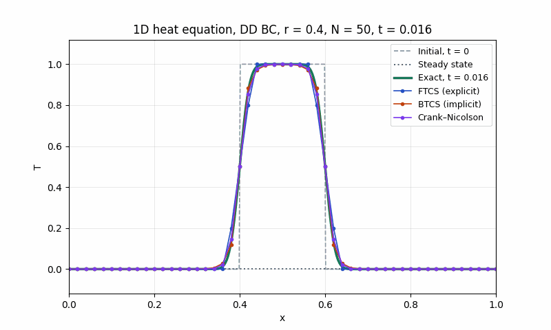
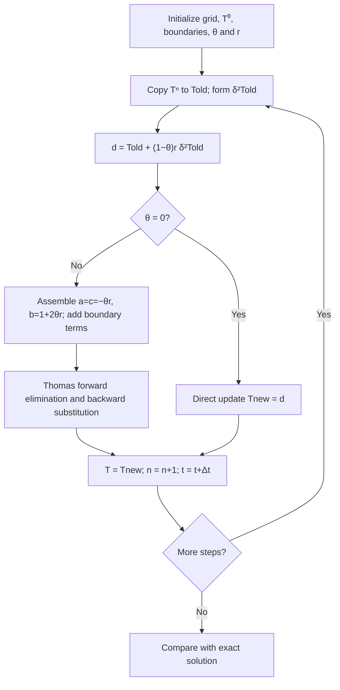

# 1D Unsteady Heat Equation: Explicit vs Implicit Time Stepping

Teaching material for a CFD course: the 1D unsteady heat equation solved with the explicit FTCS
scheme and the implicit BTCS and Crank–Nicolson schemes, plus an adjustable general explicit–implicit θ-method, compared with the exact solution.



## Interactive page

**Open it here: https://computationalgasdynamicslab.github.io/ME464/heat-equation/**

It runs in any web browser, with nothing to install. You can:

- play the solution, or step through it one time step at a time
- show FTCS, BTCS, Crank–Nicolson and a general θ-method together; all use the same $`\Delta x`$ and $`\Delta t`$
- type any diffusion number $`r`$ (0.01 to 50) and number of intervals $`N`$ (4 to 1000, so $`\Delta x`$ down to 0.001), or pick a
  preset: $`r = 1/6`$ (most accurate FTCS), 0.4 (as in the course report), 0.5 (stability limit),
  0.52 and 0.6 (FTCS unstable), 5 (implicit schemes only)
- choose the initial condition: $`\sin(\pi x)`$, zero, two sine modes, $`\cos(\pi x)`$, uniform, linear ramp,
  hat, parabola, square pulse or step
- choose the boundary conditions at each end: **Dirichlet** (fixed temperature) or **Neumann** (fixed gradient
  $`\partial T/\partial x`$, i.e. a fixed heat flux; 0 = insulated), with any value; the steady state is drawn as a
  dotted line
- try the **Neumann examples**: an insulated rod, heat flux in at one end, flux straight through, and net
  heating with no steady state
- read the maximum error of each scheme against the exact solution, and zoom in to see it
- run a **grid convergence study**: list several $`N`$ values, refine with fixed $`r`$ or fixed
  $`\Delta t/\Delta x`$, and get a table of errors and observed orders plus a log-log plot with
  reference slopes; copy the table as CSV for a report
- adjust the implicit weight θ from 0 to 1; inspect stability limits, modal sign changes, the weighted stencil, and the numerical algorithm
- see the amplification factor $`G(\xi)`$ of each scheme against the exact decay, and the
  explicit and implicit stencils

## Classroom demonstration: explicit versus implicit

The page starts paused with FTCS, BTCS and the general θ-method (initially θ = ½) visible together on the same grid and time step.
Use **Step +1** to discuss the old and new time levels, or **Play** to animate.

1. **Both stable (r = 0.4):** compare both solutions and their maximum errors against the exact solution. Zoom near the peak to see the difference.
2. **Explicit instability (r = 0.6):** a square pulse excites short waves immediately. FTCS develops growing oscillations while BTCS remains stable.
3. **Large implicit step (r = 5):** take two steps to the same final time as the first experiment. BTCS stays stable, but its error demonstrates that stability does not guarantee accuracy. A smooth sine can hide FTCS instability over just two steps; try the pulse to excite short waves.

Each experiment resets the grid, initial condition, zero Dirichlet boundaries, time step and visible methods, and pauses at the initial condition.
The notes show the BTCS tridiagonal matrix and a one-step hand check for both methods.
Crank–Nicolson remains available as an optional comparison.

Open `index.html` directly in a browser; no installation is required.
Run the dependency-free numerical checks with Node.js from this folder:

```bash
node test_heat1d.cjs
```

Run `python test_heat1d.py` for the Python kernels (requires the solver dependencies).

The checks cover θ-method equivalence, stability thresholds, discrete modal amplification, the hand calculation, explicit instability,
Dirichlet and Neumann boundaries, heat conservation and grid convergence.

The web simulation starts with a final time of **100** and accepts values up to **1000**, including for convergence studies. Longer physical runs also play for longer; adjust **Speed** to accelerate playback. Classroom experiment buttons retain their shorter teaching intervals. The Python solver accepts `--t-end 1000` and keeps its default final time of 10.

## Side-by-side comparison with independent time steps

The **Side by side** section uses the same grid, initial condition and boundary conditions as the main demo,
but lets FTCS and BTCS use independent diffusion numbers (and hence independent time steps).
The defaults are r = 0.4 for FTCS and r = 5 for BTCS.

Press **Step to next shared time** or **Play comparison**. Both plots show the same physical time,
use identical axes and include the exact solution, maximum error and number of steps.
For an especially clear example, select N = 10: the requested steps are Δt = 0.4 and Δt = 5.
At each shared time interval of 5, FTCS takes twelve steps of 0.4 and one shortened step of 0.2,
while BTCS takes one step of 5. By t = 10 the counts are 26 and 2.

The last substep is shortened whenever necessary to synchronize the methods or reach the final time.
Changing the main problem parameters resets the comparison. Independent comparison controls do not change
the original shared-step plot. Counts measure numerical steps; a BTCS step also requires a tridiagonal solve,
so the counts do not directly measure CPU time.

## The problem

```math
\frac{\partial T}{\partial t} = \alpha \frac{\partial^2 T}{\partial x^2}, \qquad 0 < x < L, \quad t > 0
```

with $`L = 1`$, $`\alpha = 0.01`$, $`T(0,t) = T(L,t) = 0`$ and $`T(x,0) = \sin(\pi x / L)`$. The exact solution is

```math
T(x,t) = \sin\left(\frac{\pi x}{L}\right) e^{-\alpha \pi^2 t / L^2}
```

This is the default problem. For the other initial conditions each sine mode $`\sin(k\pi x/L)`$ decays like $`e^{-\alpha k^2\pi^2 t/L^2}`$:
short waves die much faster than long ones. The square pulse uses its Fourier sine series.

The grid is $`x_i = i\Delta x`$ with $`\Delta x = L/N`$, and all schemes use the diffusion number

```math
r = \frac{\alpha \Delta t}{\Delta x^2}
```

## Boundary conditions

Each end is either Dirichlet or Neumann:

```math
\text{Dirichlet: } T(0,t) = T_0, \qquad \text{Neumann: } \frac{\partial T}{\partial x}(1,t) = g_1
```

The heat flux is $`q = -k \partial T/\partial x`$, so $`g = 0`$ is an insulated end. At a Dirichlet end the
boundary node is known. At a Neumann end it is an unknown, and its equation uses a ghost node outside the
domain, found from the second-order central difference:

```math
\frac{T_{N+1} - T_{N-1}}{2\Delta x} = g_1 \quad\Rightarrow\quad T_{N+1} = T_{N-1} + 2\Delta x  g_1
```

(and $`T_{-1} = T_1 - 2\Delta x  g_0`$ at $`x = 0`$). The exact solution is a particular solution that
satisfies the boundary conditions plus a Fourier series: sines for Dirichlet–Dirichlet, cosines for
Neumann–Neumann, and quarter-wave modes $`(k - 1/2)\pi`$ for the mixed cases. The series
coefficients are computed in closed form.

With Neumann conditions at both ends, the total heat changes only through the boundary flux:

```math
\frac{d}{dt}\int_0^L T  dx = \alpha \left[ \frac{\partial T}{\partial x}(L) - \frac{\partial T}{\partial x}(0) \right]
```

With $`g_0 = g_1`$ the mean is conserved and the profile settles to a straight line. With $`g_0 \ne g_1`$ there
is no steady state: the temperature keeps rising (or falling) at the rate $`\alpha (g_1 - g_0)`$.

## Grid convergence: observing the order

If the error behaves like $`E \approx C \Delta x^p`$, two grids give the observed order

```math
p = \frac{\ln(E_{coarse} / E_{fine})}{\ln(\Delta x_{coarse} / \Delta x_{fine})}
```

so halving $`\Delta x`$ cuts the error by $`2^p`$. How $`\Delta t`$ is refined decides what you see:

| Refinement | FTCS | BTCS | Crank–Nicolson |
|---|---|---|---|
| fixed $`r`$, so $`\Delta t \propto \Delta x^2`$ | 2 (4 at $`r = 1/6`$); unstable for $`r > 1/2`$ | 2 | 2 |
| fixed $`\Delta t/\Delta x`$, so $`\Delta t \propto \Delta x`$ | unstable once $`r > 1/2`$ on fine grids | 1 | 2 |

With fixed $`r`$ the first-order time error of FTCS and BTCS is $`O(\Delta t) = O(\Delta x^2)`$, so every scheme
looks second order. Only with $`\Delta t \propto \Delta x`$ does the time order show: BTCS drops to first
order and Crank–Nicolson stays second order. Both the page and `python heat1d.py --study ...` print errors and observed orders. Smooth initial conditions that match the boundary values give the design order; a discontinuous one
lowers it.

## Scheme 1: FTCS (explicit)

```math
T_i^{n+1} = T_i^n + r\left(T_{i+1}^n - 2T_i^n + T_{i-1}^n\right) = r T_{i-1}^n + (1 - 2r) T_i^n + r T_{i+1}^n
```

Each new value comes directly from known values. The error is $`O(\Delta t) + O(\Delta x^2)`$. The modified equation is

```math
T_t = \alpha T_{xx} + \frac{\alpha \Delta x^2}{12}(1 - 6r) T_{xxxx} + \dots
```

so at $`r = 1/6`$ the leading error cancels and FTCS becomes fourth order in $`\Delta x`$.

## Scheme 2: BTCS (fully implicit)

```math
-r T_{i-1}^{n+1} + (1 + 2r) T_i^{n+1} - r T_{i+1}^{n+1} = T_i^n
```

The unknowns at $`n+1`$ are coupled, so each step solves a tridiagonal system with the Thomas
algorithm. The error is still $`O(\Delta t) + O(\Delta x^2)`$.

## Scheme 3: Crank–Nicolson

```math
-\frac{r}{2} T_{i-1}^{n+1} + (1 + r) T_i^{n+1} - \frac{r}{2} T_{i+1}^{n+1} = \frac{r}{2} T_{i-1}^n + (1 - r) T_i^n + \frac{r}{2} T_{i+1}^n
```

The average of FTCS and BTCS, with error $`O(\Delta t^2) + O(\Delta x^2)`$.

## General explicit–implicit θ-method

Let θ be the **implicit weight**, with 0 ≤ θ ≤ 1. Use ξ = kΔx for wave phase to avoid confusing it with θ.

```math
T_i^{n+1}-T_i^n=r[(1-\theta)\delta^2T_i^n+\theta\delta^2T_i^{n+1}],
\qquad \delta^2T_i=T_{i-1}-2T_i+T_{i+1}.
```

Rearranging gives the tridiagonal equations

```math
-\theta r T_{i-1}^{n+1}+(1+2\theta r)T_i^{n+1}-\theta r T_{i+1}^{n+1}
=(1-\theta)rT_{i-1}^n+[1-2(1-\theta)r]T_i^n+(1-\theta)rT_{i+1}^n.
```

| θ | Method | Time error for smooth solutions |
|---|---|---|
| 0 | FTCS / forward Euler | O(Δt) |
| ¼ | 75% explicit, 25% implicit | O(Δt) |
| ½ | Crank–Nicolson | O(Δt²) |
| ¾ | 25% explicit, 75% implicit | O(Δt) |
| 1 | BTCS / backward Euler | O(Δt) |

The spatial error is O(Δx²). Under fixed-r refinement, Δt ∝ Δx² gives joint order 2 for general θ, subject to stability and smooth compatible data. Under fixed Δt/Δx refinement, θ ≠ ½ generally gives order 1, whereas θ = ½ gives order 2. Error cancellation at special fixed-r combinations can give higher observed order.

### Numerical algorithm



Keep the old array separate while assembling all rows. Updating in place from already changed neighbors would implement a different method. For a Dirichlet boundary, add θr times its **new** prescribed value to the first or last RHS; the old boundary is already included in δ²Told. The supplied solvers use constant boundary data. For time-dependent data, use the old and new boundary values at their respective levels.

For a Neumann endpoint, eliminate the ghost node before assembling. At the left end, a row has inner-neighbor coefficient −2θr and new-level forcing −2θrΔx g₀; at the right, −2θr and +2θrΔx g₁. The old-level flux contribution is included in δ²Told.

For θ > 0, Thomas solves aᵢTᵢ₋₁ + bᵢTᵢ + cᵢTᵢ₊₁ = dᵢ in O(N):

```text
Forward: c′₀ = c₀/b₀; d′₀ = d₀/b₀
         pᵢ = bᵢ − aᵢ c′ᵢ₋₁
         c′ᵢ = cᵢ/pᵢ; d′ᵢ = (dᵢ − aᵢ d′ᵢ₋₁)/pᵢ
Backward: Tnew[last] = d′[last]
          Tnew[i] = d′[i] − c′[i] Tnew[i+1]
```

The page illustrates the known and unknown stencil nodes, shows the current coefficients, and links to the [Thomas algorithm lab](../thomas-algorithm/).

## Stability: growth, sign flips, and accuracy

Substitute a Fourier error mode $`e_j^n=G^n e^{ij\xi}`$ and set $`s=\sin^2(\xi/2)`$:

```math
G_\theta=\frac{1-4(1-\theta)rs}{1+4\theta rs}.
```

For r ≥ 0 and 0 ≤ θ ≤ 1, the denominator is positive and G ≤ 1 automatically. The remaining condition G ≥ −1 gives

```math
2(1-2\theta)rs\le1.
```

For **all wavelengths** (s ≤ 1), the stability requirement is:

| Method | Stable: every \|G\| ≤ 1 | No modal sign flips: every G ≥ 0 |
|---|---|---|
| FTCS (θ = 0) | r ≤ ½ | r ≤ ¼ |
| θ = ¼ | r ≤ 1 | r ≤ ⅓ |
| CN (θ = ½) | any r ≥ 0 | r ≤ ½ |
| θ = ¾ | any r ≥ 0 | r ≤ 1 |
| BTCS (θ = 1) | any r ≥ 0 | any r ≥ 0 |
| General θ | r ≤ 1/[2(1−2θ)] if θ < ½; any r if θ ≥ ½ | r ≤ 1/[4(1−θ)] if θ < 1; any r at θ = 1 |

Convert an r limit to a time-step limit with Δt ≤ r_limit Δx²/α. These are linear diffusion stability results for this 1D centered spatial operator, not general rules for arbitrary PDEs or spatial discretizations.

**Finite-grid limits.** The actual grid has a discrete set of modes. Replace the upper bound s = 1 by s_max = sin²(ξ_max/2):

- DD: ξ_max = (N−1)π/N.
- NN: ξ_max = π. Its constant mode has G = 1; equal gradients conserve trapezoidally weighted total heat.
- Mixed DN/ND with the supplied ghost-node discretization: ξ_max = (N−½)π/N.

Divide each finite all-wave limit in the table by s_max to get the grid limit. For example, N = 4 with DD has FTCS limit r ≈ 0.585786; r = 0.52 is stable on that grid, although it exceeds the uniform all-wavelength bound. The page reports both limits and only estimates round-off growth when an actual grid mode has |G| > 1. Fixed nonzero boundary values change the forcing, not these error-amplification eigenvalues.

**Stable alternating modes** have −1 ≤ G < 0: they flip sign without growing. This differs from an unstable mode with |G| > 1. At equality G = −1 a mode persists without damping. Negative modal G also differs from loss of positivity of the complete temperature field. A sufficient positivity condition with homogeneous boundaries is r ≤ 1/[2(1−θ)] for θ < 1; BTCS preserves positivity for all r. FTCS, for instance, can preserve nonnegative temperatures at r = 0.4 while some Fourier components alternate.

**Damping and accuracy.** The continuum decay is exp(−rξ²); exact time integration of the discrete spatial operator gives exp(−4rs). BTCS has G > 0 and damps stiff modes toward zero as r grows. CN is stable for any r but G → −1 for stiff modes, producing persistent alternating wiggles near sharp data. More generally, for θ > 0, G → −(1−θ)/θ as rs → ∞. A large stable step can still have substantial time error.

Try θ = ¼ with a square pulse at r = 0.8 and then r = 1.2; compare θ = ½ and θ = 1 at r = 5. Use the mode inspector to follow amplitudes Gⁿ, then use Step +1 to compare the full numerical profiles.

## Run the Python script on your own computer

You only need this if you want to run or modify the Python code. The interactive page above
works in a browser without installing anything.

### Step 1: Install Python (one time)

You need Python 3.9 or newer. To check whether you already have it, open a terminal
(see below) and type `python3 --version` (macOS/Linux) or `py --version` (Windows).

- **Windows:** download the installer from https://www.python.org/downloads/ and run it.
  On the first screen, **check the box "Add python.exe to PATH"** before clicking Install.
- **macOS:** download the installer from https://www.python.org/downloads/ and run it.
  (If you use Homebrew, `brew install python` also works.)
- **Linux:** Python 3 is usually already installed. On Ubuntu/Debian, also run
  `sudo apt install python3-venv python3-pip`.

**How to open a terminal**
- Windows: press the Windows key, type `PowerShell`, and open **Windows PowerShell**.
- macOS: press Cmd + Space, type `Terminal`, and press Enter.
- Linux: press Ctrl + Alt + T.

### Step 2: Download the code

Pick one:

- **Without Git (easiest):** on the [ME464 repository page](https://github.com/ComputationalGasDynamicsLab/ME464),
  click the green **Code** button, then **Download ZIP**. Unzip it, for example into your
  Documents folder. The folder will be called `ME464-main`, and this example is in its
  `heat-equation` subfolder.
- **With Git:**
  ```bash
  git clone https://github.com/ComputationalGasDynamicsLab/ME464.git
  ```

Then move the terminal into this example's folder, for example:

```bash
cd Documents/ME464-main/heat-equation    # ZIP download
cd ME464/heat-equation                   # git clone
```

Use the location you actually have. All commands below are run from this folder.

Tip: type `cd ` (with a space) and then drag the folder from your file browser into the
terminal window; it fills in the path for you.

### Step 3: Create a virtual environment and install the packages (one time)

A virtual environment keeps this course's packages separate from the rest of your computer.

**Windows (PowerShell):**
```powershell
py -m venv .venv
.venv\Scripts\Activate.ps1
pip install -r requirements.txt
```

**macOS / Linux:**
```bash
python3 -m venv .venv
source .venv/bin/activate
pip install -r requirements.txt
```

When the environment is active, your prompt starts with `(.venv)`.

### Step 4: Run the solver

```bash
python heat1d.py                            # FTCS, BTCS and CN at r = 0.4, N = 50, t = 10
python heat1d.py --scheme theta --theta 0.25 --r 0.8 --ic pulse  # general blend
python heat1d.py --r 0.6                    # FTCS unstable
python heat1d.py --r 0.1666666667 --t-end 1 # r = 1/6: FTCS fourth order
python heat1d.py --r 5 --ic pulse --t-end 1 # implicit only; Crank-Nicolson wiggles
python heat1d.py --scheme ftcs --N 10 --r 0.1 --t-end 0.1   # the coarse-mesh case of the report
python heat1d.py --bc nn --ic hat           # Neumann, insulated rod: relaxes to its mean
python heat1d.py --bc dn --v1 1 --ic zero   # Dirichlet T = 0 at x = 0, heat flux in at x = 1
python heat1d.py --bc nn --v1 1 --ic zero   # Neumann, net heating: no steady state
python heat1d.py --study 10 20 40 80 160 --r 0.25 --t-end 1   # convergence, fixed r
python heat1d.py --study 10 20 40 80 160 --lam 1 --t-end 1    # convergence, fixed dt/dx
python heat1d.py --animate                  # also saves an animated GIF
python heat1d.py --help                     # all options
```

Each run prints $`\Delta x`$, $`\Delta t`$, the number of steps and the maximum error of each
scheme (or the step at which it blew up), and saves the plot `heat1d.png` (and `heat1d.gif` with
`--animate`) in the same folder. Open those files to see the results.

Options you can combine:

| Option | Meaning | Default |
|---|---|---|
| `--scheme` | one or more of `ftcs`, `btcs`, `cn`, `theta` | FTCS, BTCS, CN |
| `--theta` | implicit weight for `--scheme theta`, between 0 and 1 | 0.5 |
| `--r` | diffusion number $`r = \alpha \Delta t / \Delta x^2`$ | 0.4 |
| `--N` | number of intervals, $`\Delta x = 1/N`$ | 50 |
| `--t-end` | final time, up to 1000 (the run stops at the last whole step before it) | 10 |
| `--ic` | initial condition: `sine`, `zero`, `modes`, `cosine`, `uniform`, `ramp`, `hat`, `parabola`, `pulse` or `step` | `sine` |
| `--bc` | boundary conditions at $`x = 0`$ then $`x = 1`$: `d` = Dirichlet, `n` = Neumann, e.g. `dd`, `dn`, `nd`, `nn` | `dd` |
| `--v0`, `--v1` | boundary values at $`x = 0`$ and $`x = 1`$: $`T`$ for Dirichlet, $`\partial T/\partial x`$ for Neumann | 0 |
| `--animate` | also save `heat1d.gif` | off |
| `--study` | grid convergence study over these $`N`$ values (prints a table of errors and orders) | off |
| `--lam` | with `--study`: fix $`\Delta t/\Delta x`$ instead of $`r`$ | off (fixed $`r`$) |

Expected output of `python heat1d.py`:

```
Dirichlet at both ends, v0 = 0, v1 = 0, initial condition sine
r = 0.4, N = 50, dx = 0.02, dt = 0.016, steps = 625, t = 10
  FTCS (explicit)    max |T - T_exact| = 1.695e-04
  BTCS (implicit)    max |T - T_exact| = 4.112e-04
  Crank–Nicolson     max |T - T_exact| = 1.209e-04
```

### Next time

The installation is one time only. Next time, open a terminal, `cd` into the folder,
activate the environment (`.venv\Scripts\Activate.ps1` on Windows,
`source .venv/bin/activate` on macOS/Linux) and run the script.

### Troubleshooting

| Problem | Fix |
|---|---|
| `python` or `py` is "not recognized" / "command not found" | Python is not installed or not on PATH. On Windows, rerun the installer, choose **Modify**, and enable **Add Python to environment variables**. On macOS/Linux use `python3` instead of `python` before the environment is activated. |
| Windows: "running scripts is disabled on this system" when activating | Run `Set-ExecutionPolicy -Scope CurrentUser RemoteSigned` once in PowerShell, answer `Y`, then activate again. Or use Command Prompt and run `.venv\Scripts\activate.bat`. |
| `ModuleNotFoundError: No module named 'numpy'` (or `matplotlib`) | The environment is not active, or Step 3 was skipped. Activate it and run `pip install -r requirements.txt`. |
| `No such file or directory: 'heat1d.py'` / `requirements.txt` | The terminal is not inside the code folder. Use `cd` to go to the folder that contains these files (`dir` on Windows or `ls` on macOS/Linux lists them). |
| Linux: `ensurepip is not available` | Run `sudo apt install python3-venv` and repeat Step 3. |
| You use Anaconda | Skip the virtual environment. Open **Anaconda Prompt**, `cd` into the folder and run `python heat1d.py`; numpy and matplotlib are already included. |
| pip prints "WARNING: You are using pip version …; you should consider upgrading" | Safe to ignore. Optionally run `python -m pip install --upgrade pip`. |
