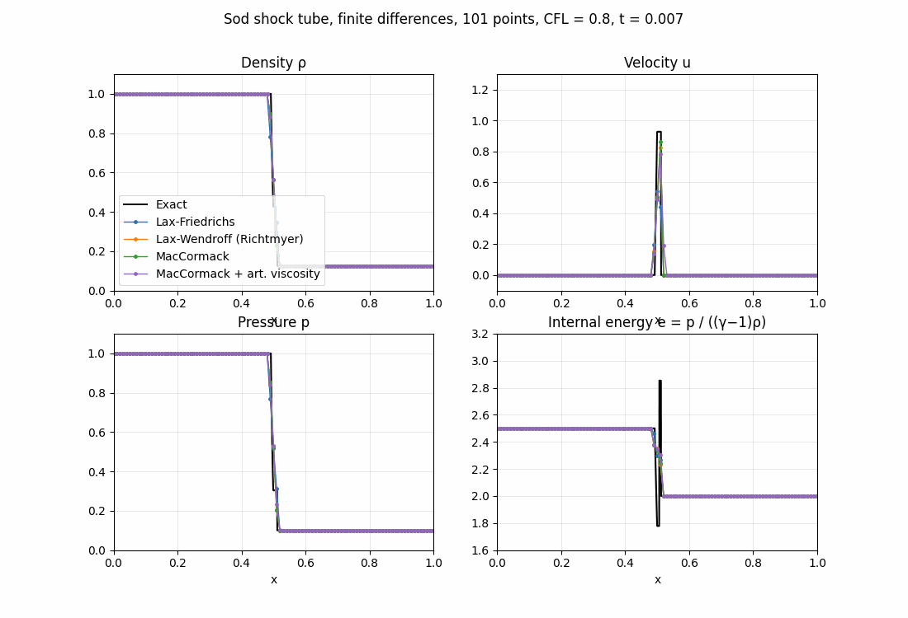

# Sod Shock Tube: Finite-Difference Schemes

Teaching material for a CFD course: the Sod shock tube problem for the 1D Euler equations,
solved with classic finite-difference schemes (Lax–Friedrichs, Lax–Wendroff, MacCormack, and
MacCormack with artificial viscosity) and compared with the exact solution. The finite-volume version with Riemann
solvers is in [`../sod-shock-tube/`](../sod-shock-tube/).



## Interactive animation

**Open it here: https://computationalgasdynamicslab.github.io/ME464/sod-shock-tube-fd/**

It runs in any web browser, with nothing to install. You can:

- play the solution, or step through it one time step at a time
- switch between density, velocity, pressure and internal energy
- show or hide each scheme, compared with the exact solution
- type any CFL number, artificial-viscosity coefficient $`C_x`$ and number of grid points
- zoom in: drag a box on the plot (for example around the shock), use the + and − buttons,
  and double-click or **Reset view** to zoom back out
- compare the L1 error in density for each scheme

## The equations and the problem

```math
\frac{\partial U}{\partial t} + \frac{\partial F(U)}{\partial x} = 0, \qquad
U = \begin{pmatrix} \rho \\ \rho u \\ E \end{pmatrix}, \qquad
F = \begin{pmatrix} \rho u \\ \rho u^2 + p \\ u (E + p) \end{pmatrix}, \qquad
p = (\gamma - 1)\left(E - \tfrac{1}{2}\rho u^2\right)
```

with $`\gamma = 1.4`$ on $`0 \le x \le 1`$, run to $`t = 0.2`$:

| | $`\rho`$ | $`u`$ | $`p`$ |
|---|---|---|---|
| left, $`x < 0.5`$ | 1.000 | 0 | 1.0 |
| right, $`x > 0.5`$ | 0.125 | 0 | 0.1 |

## Finite differences

The solution is stored at grid points $`x_i = i\,\Delta x`$, $`i = 0, \dots, n_x - 1`$, and the
flux derivative is replaced by differences of $`F_i = F(U_i)`$ at neighboring points. With
$`\lambda = \Delta t / \Delta x`$ and $`\Delta t = \mathrm{CFL}\,\Delta x / \max_i(|u_i| + a_i)`$:

**Lax–Friedrichs** (1st order)

```math
U_i^{n+1} = \frac{1}{2}\left(U_{i+1}^n + U_{i-1}^n\right) - \frac{\lambda}{2}\left(F_{i+1}^n - F_{i-1}^n\right)
```

**Lax–Wendroff, Richtmyer two-step form** (2nd order)

```math
U_{i+1/2}^{n+1/2} = \frac{1}{2}\left(U_i^n + U_{i+1}^n\right) - \frac{\lambda}{2}\left(F_{i+1}^n - F_i^n\right), \qquad
U_i^{n+1} = U_i^n - \lambda\left(F_{i+1/2}^{n+1/2} - F_{i-1/2}^{n+1/2}\right)
```

**MacCormack** (2nd order): forward-difference predictor, backward-difference corrector

```math
U_i^{*} = U_i^n - \lambda\left(F_{i+1}^n - F_i^n\right), \qquad
U_i^{n+1} = \frac{1}{2}\left[U_i^n + U_i^{*} - \lambda\left(F_i^{*} - F_{i-1}^{*}\right)\right]
```

**MacCormack with artificial viscosity** (Anderson, *Computational Fluid Dynamics: The Basics
with Applications*, ch. 7). A pressure-switched second-difference term

```math
S_i = C_x \frac{\left|p_{i+1} - 2p_i + p_{i-1}\right|}{p_{i+1} + 2p_i + p_{i-1}}\left(U_{i+1} - 2U_i + U_{i-1}\right)
```

is added to the predictor (computed from $`U^n`$) and to the corrector (computed from $`U^*`$):

```math
U_i^{*} = U_i^n - \lambda\left(F_{i+1}^n - F_i^n\right) + S_i^n, \qquad
U_i^{n+1} = U_i^n - \frac{\lambda}{2}\left[\left(F_{i+1}^n - F_i^n\right) + \left(F_i^{*} - F_{i-1}^{*}\right)\right] + S_i^{*}
```

The pressure switch is close to zero where the pressure is smooth and large at a shock, so the
damping acts mainly where it is needed. The default is $`C_x = 0.3`$; $`C_x = 0`$ gives plain
MacCormack.

Boundary points copy their neighbor (transmissive), and a grid point exactly at $`x = 0.5`$
starts with the average of the two states.

Each scheme takes its own time step from its own solution, in both the script and the page.

## Results

L1 error in density, $`\Delta x \sum_i |\rho_i - \rho_{exact}(x_i)|`$, at $`t = 0.2`$ with 101 points;
the last column is the largest velocity (exact maximum 0.927):

| CFL | Lax–Friedrichs | Lax–Wendroff | MacCormack | MacCormack + AV ($`C_x = 0.3`$) | max $`u`$ (LW / MacC / MacC + AV) |
|---|---|---|---|---|---|
| 0.3 | 0.04687 | 0.01393 | 0.01292 | 0.00952 | 1.31 / 1.16 / 1.02 |
| 0.5 | 0.03866 | 0.01191 | 0.01094 | 0.00897 | 1.21 / 1.12 / 1.01 |
| 0.8 | 0.03078 | 0.00946 | 0.00869 | 0.00812 | 1.09 / 1.06 / 0.97 |

Effect of $`C_x`$ on MacCormack + AV (CFL 0.8, 101 points):

| $`C_x`$ | 0 | 0.1 | 0.2 | 0.3 | 0.5 | 1.0 |
|---|---|---|---|---|---|---|
| L1 error | 0.00869 | 0.00829 | 0.00814 | 0.00812 | 0.00822 | 0.00909 |
| max $`u`$ | 1.056 | 0.994 | 0.977 | 0.969 | 0.957 | 0.953 |

With 401 points at CFL 0.8: Lax–Friedrichs 0.01496, Lax–Wendroff 0.00346, MacCormack 0.00303.

What to look for:

- **Lax–Friedrichs** is smooth but badly smeared. Its numerical viscosity is about
  $`\frac{\Delta x^2}{2\Delta t}(1 - c^2)`$, so a smaller time step makes it worse, not better.
- **Lax–Wendroff and MacCormack** are about 3× more accurate but oscillate behind the shock,
  around the contact and at the tail of the expansion fan. This is numerical dispersion, the
  same behavior as Lax–Wendroff in the [linear convection lab](../ftbs-linear-convection/).
- **Godunov's theorem** explains why: a linear scheme that does not create new oscillations is
  at most first order. The classic fix is artificial viscosity near shocks; the modern fixes are
  TVD limiters and upwind Riemann solvers, as in the [finite-volume Sod example](../sod-shock-tube/).
- **Artificial viscosity** removes most of the MacCormack overshoot and lowers the error. More is
  not always better: past $`C_x \approx 0.3`$ the error rises again because the shock is smeared,
  and $`C_x = 1`$ at CFL 0.3 is unstable, because the added diffusion term has its own explicit
  stability limit (a smaller time step does not help, since $`S_i`$ is added in full every step).
- **Stability:** the schemes need CFL ≤ 1 based on $`|u| + a`$. Because that speed is reached at
  only a few points, a small violation can survive to $`t = 0.2`$. At CFL 1.3 MacCormack fails and
  Lax–Wendroff is on the edge; at CFL 1.5 all three fail.

## Run the Python script on your own computer

You only need this if you want to run or modify the Python code. The interactive page above
works in a browser without installing anything.

### Step 1: Install Python (one time)

You need Python 3.9 or newer. To check whether you already have it, open a terminal
(see below) and type `python3 --version` (macOS/Linux) or `py --version` (Windows).

- **Windows:** download the installer from https://www.python.org/downloads/ and run it.
  On the first screen, **check the box "Add python.exe to PATH"** before clicking Install.
- **macOS:** download the installer from https://www.python.org/downloads/ and run it.
  (If you use Homebrew, `brew install python` also works.)
- **Linux:** Python 3 is usually already installed. On Ubuntu/Debian, also run
  `sudo apt install python3-venv python3-pip`.

**How to open a terminal**
- Windows: press the Windows key, type `PowerShell`, and open **Windows PowerShell**.
- macOS: press Cmd + Space, type `Terminal`, and press Enter.
- Linux: press Ctrl + Alt + T.

### Step 2: Download the code

Pick one:

- **Without Git (easiest):** on the [ME464 repository page](https://github.com/ComputationalGasDynamicsLab/ME464),
  click the green **Code** button, then **Download ZIP**. Unzip it, for example into your
  Documents folder. The folder will be called `ME464-main`, and this example is in its
  `sod-shock-tube-fd` subfolder.
- **With Git:**
  ```bash
  git clone https://github.com/ComputationalGasDynamicsLab/ME464.git
  ```

Then move the terminal into this example's folder, for example:

```bash
cd Documents/ME464-main/sod-shock-tube-fd    # ZIP download
cd ME464/sod-shock-tube-fd                   # git clone
```

Use the location you actually have. All commands below are run from this folder.

Tip: type `cd ` (with a space) and then drag the folder from your file browser into the
terminal window; it fills in the path for you.

### Step 3: Create a virtual environment and install the packages (one time)

A virtual environment keeps this course's packages separate from the rest of your computer.

**Windows (PowerShell):**
```powershell
py -m venv .venv
.venv\Scripts\Activate.ps1
pip install -r requirements.txt
```

**macOS / Linux:**
```bash
python3 -m venv .venv
source .venv/bin/activate
pip install -r requirements.txt
```

When the environment is active, your prompt starts with `(.venv)`.

### Step 4: Run the solver

```bash
python sod_fd.py                       # all four schemes, 101 points, CFL 0.8
python sod_fd.py --cfl 0.3             # smaller time step: more smearing and bigger wiggles
python sod_fd.py --cfl 1.5             # unstable: all three schemes fail
python sod_fd.py --scheme mc --nx 401  # one scheme, finer grid
python sod_fd.py --scheme mc mcav --cx 0.5   # MacCormack with and without artificial viscosity
python sod_fd.py --animate             # also saves an animated GIF
python sod_fd.py --help                # all options
```

Each run prints, for each scheme, the number of time steps, the L1 error in density and the
maximum velocity (the exact value behind the shock is 0.927, so anything above it is overshoot).
It saves a 2×2 plot of density, velocity, pressure and internal energy as `sod_fd.png`
(and `sod_fd.gif` with `--animate`) in the same folder.

| Option | Meaning | Default |
|---|---|---|
| `--scheme` | one or more of `lf` (Lax–Friedrichs), `lw` (Lax–Wendroff), `mc` (MacCormack), `mcav` (MacCormack + artificial viscosity) | all four |
| `--cx` | artificial-viscosity coefficient for `mcav` | 0.3 |
| `--cfl` | CFL number | 0.8 |
| `--nx` | number of grid points | 101 |
| `--t-end` | final time | 0.2 |
| `--animate` | also save `sod_fd.gif` | off |

Example: `python sod_fd.py --scheme lw mc --cfl 0.5 --nx 201`

### Next time

The installation is one time only. Next time, open a terminal, `cd` into the folder,
activate the environment (`.venv\Scripts\Activate.ps1` on Windows,
`source .venv/bin/activate` on macOS/Linux) and run the script.

### Troubleshooting

| Problem | Fix |
|---|---|
| `python` or `py` is "not recognized" / "command not found" | Python is not installed or not on PATH. On Windows, rerun the installer, choose **Modify**, and enable **Add Python to environment variables**. On macOS/Linux use `python3` instead of `python` before the environment is activated. |
| Windows: "running scripts is disabled on this system" when activating | Run `Set-ExecutionPolicy -Scope CurrentUser RemoteSigned` once in PowerShell, answer `Y`, then activate again. Or use Command Prompt and run `.venv\Scripts\activate.bat`. |
| `ModuleNotFoundError: No module named 'numpy'` (or `matplotlib`) | The environment is not active, or Step 3 was skipped. Activate it and run `pip install -r requirements.txt`. |
| `No such file or directory: 'sod_fd.py'` / `requirements.txt` | The terminal is not inside the code folder. Use `cd` to go to the folder that contains these files (`dir` on Windows or `ls` on macOS/Linux lists them). |
| Linux: `ensurepip is not available` | Run `sudo apt install python3-venv` and repeat Step 3. |
| You use Anaconda | Skip the virtual environment. Open **Anaconda Prompt**, `cd` into the folder and run `python sod_fd.py`; numpy and matplotlib are already included. |
| pip prints "WARNING: You are using pip version …; you should consider upgrading" | Safe to ignore. Optionally run `python -m pip install --upgrade pip`. |
