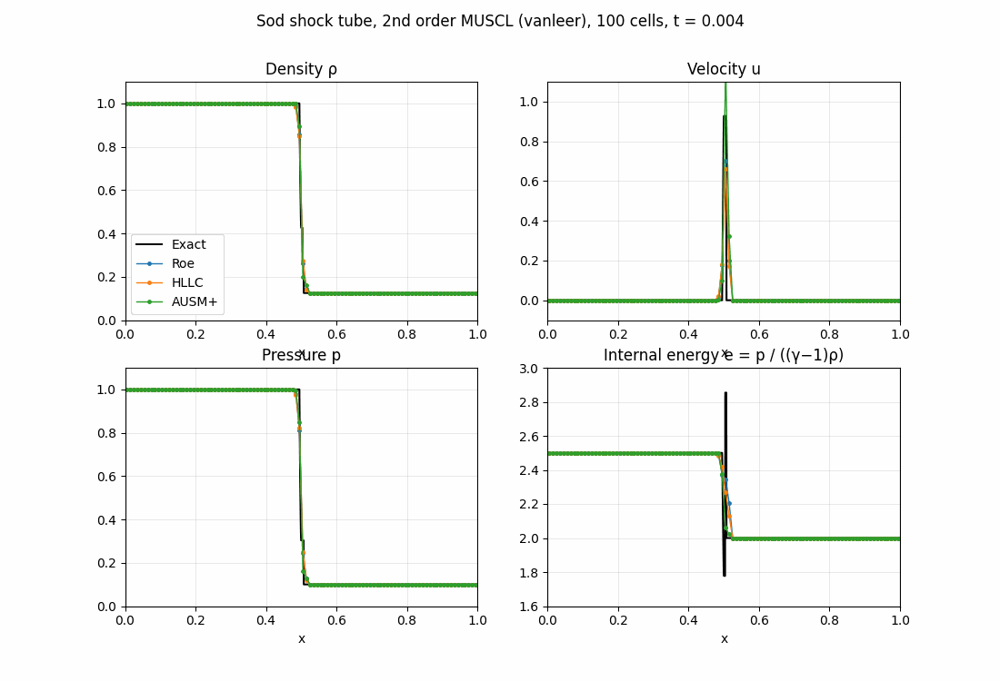

# Sod Shock Tube: Roe, HLLC, AUSM+ and AUSM+-up

Teaching material for a CFD course: the Sod shock tube problem for the 1D Euler equations,
solved with a finite-volume method and four approximate Riemann solvers (Roe, HLLC, AUSM+
and AUSM+-up), compared with the exact solution.



## Interactive animation

**Open it here: https://computationalgasdynamicslab.github.io/ME464/sod-shock-tube/**

It runs in any web browser, with nothing to install. You can:

- play the solution, or step through it one time step at a time
- switch between density, velocity, pressure and internal energy
- show or hide Roe, HLLC, AUSM+ and AUSM+-up, compared with the exact solution
- choose 1st order or 2nd order (MUSCL with a minmod, van Leer or superbee limiter)
- type any CFL number and number of cells
- zoom in: drag a box on the plot (for example around the contact), use the + and − buttons,
  and double-click or **Reset view** to zoom back out
- compare the L1 error in density for each scheme

## The equations

```math
\frac{\partial U}{\partial t} + \frac{\partial F(U)}{\partial x} = 0, \qquad
U = \begin{pmatrix} \rho \\ \rho u \\ E \end{pmatrix}, \qquad
F = \begin{pmatrix} \rho u \\ \rho u^2 + p \\ u (E + p) \end{pmatrix}
```

```math
p = (\gamma - 1)\left(E - \tfrac{1}{2}\rho u^2\right), \qquad \gamma = 1.4
```

## The problem (Sod 1978)

A tube $`0 \le x \le 1`$ with a diaphragm at $`x = 0.5`$, run to $`t = 0.2`$ with transmissive
boundaries:

| | $`\rho`$ | $`u`$ | $`p`$ |
|---|---|---|---|
| left, $`x < 0.5`$ | 1.000 | 0 | 1.0 |
| right, $`x > 0.5`$ | 0.125 | 0 | 0.1 |

Breaking the diaphragm produces three waves:

- an **expansion fan** moving left,
- a **contact discontinuity** (a jump in density and internal energy, but not in pressure or velocity),
- a **shock** moving right.

The exact solution comes from an exact Riemann solver (Toro, ch. 4). The star state between
the fan and the shock is $`p^* = 0.30313`$, $`u^* = 0.92745`$, with $`\rho^*_L = 0.42632`$ left of
the contact and $`\rho^*_R = 0.26557`$ right of it.

## Finite-volume method

```math
U_i^{n+1} = U_i^n - \frac{\Delta t}{\Delta x}\left(F_{i+1/2} - F_{i-1/2}\right), \qquad
\Delta t = \mathrm{CFL}\,\frac{\Delta x}{\max_i(|u_i| + a_i)}
```

The interface flux $`F_{i+1/2} = \mathcal{F}(W_L, W_R)`$ comes from an approximate Riemann solver
applied to the states on either side of the face.

- **1st order:** $`W_L = W_i`$, $`W_R = W_{i+1}`$ (piecewise constant).
- **2nd order (MUSCL):** reconstruct the primitive variables $`W = (\rho, u, p)`$ linearly in each
  cell with a limited slope, $`W_L = W_i + \tfrac{1}{2}\sigma_i`$ and
  $`W_R = W_{i+1} - \tfrac{1}{2}\sigma_{i+1}`$, and advance in time with two-stage SSP Runge–Kutta (Heun).

## The four fluxes

### Roe

Linearize the Riemann problem around the Roe-averaged state
($`\tilde u = \frac{\sqrt{\rho_L} u_L + \sqrt{\rho_R} u_R}{\sqrt{\rho_L} + \sqrt{\rho_R}}`$, same for $`\tilde H`$) and solve it exactly:

```math
F_{i+1/2} = \frac{1}{2}\left(F_L + F_R\right) - \frac{1}{2}\sum_{k=1}^{3} |\tilde\lambda_k|\, \alpha_k\, \tilde K_k,
\qquad \tilde\lambda = \tilde u - \tilde a,\ \tilde u,\ \tilde u + \tilde a
```

Roe's scheme can admit a non-physical expansion shock at a sonic point, so the code applies
Harten's entropy fix to the acoustic waves: if $`|\lambda| < \delta`$, replace $`|\lambda|`$ by
$`(\lambda^2 + \delta^2)/(2\delta)`$, with $`\delta = 0.1(|\tilde u| + \tilde a)`$.

### HLLC (Toro, Spruce and Speares 1994)

Assume two outer waves $`S_L = \min(u_L - a_L, u_R - a_R)`$, $`S_R = \max(u_L + a_L, u_R + a_R)`$ and
a contact wave

```math
S_* = \frac{p_R - p_L + \rho_L u_L (S_L - u_L) - \rho_R u_R (S_R - u_R)}{\rho_L (S_L - u_L) - \rho_R (S_R - u_R)}
```

with two constant star states between them. The flux is $`F_L`$, $`F_L + S_L(U_{*L} - U_L)`$,
$`F_R + S_R(U_{*R} - U_R)`$ or $`F_R`$, depending on where $`x/t = 0`$ falls. The plain HLL
solver has no contact wave and smears contacts badly; HLLC restores it.

### AUSM+ (Liou 1996)

Split the flux into a convective part and a pressure part:

```math
F_{i+1/2} = \dot m_{1/2} \begin{pmatrix} 1 \\ u \\ H \end{pmatrix}_{L\ \text{or}\ R} + \begin{pmatrix} 0 \\ p_{1/2} \\ 0 \end{pmatrix},
\qquad \dot m_{1/2} = a_{1/2}\, m_{1/2} \begin{cases} \rho_L, & m_{1/2} > 0 \\ \rho_R, & m_{1/2} \le 0 \end{cases}
```

```math
m_{1/2} = \mathcal{M}^+_{(4)}(M_L) + \mathcal{M}^-_{(4)}(M_R), \qquad
p_{1/2} = \mathcal{P}^+_{(5)}(M_L)\, p_L + \mathcal{P}^-_{(5)}(M_R)\, p_R, \qquad M_{L,R} = \frac{u_{L,R}}{a_{1/2}}
```

For $`|M| < 1`$ the split functions are

```math
\mathcal{M}^\pm_{(4)}(M) = \pm\tfrac{1}{4}(M \pm 1)^2 \pm \beta (M^2 - 1)^2, \qquad
\mathcal{P}^\pm_{(5)}(M) = \tfrac{1}{4}(M \pm 1)^2 (2 \mp M) \pm \alpha M (M^2 - 1)^2
```

with $`\alpha = 3/16`$, $`\beta = 1/8`$. For $`|M| \ge 1`$ they reduce to full upwinding:
$`\mathcal{M}^\pm = \tfrac{1}{2}(M \pm |M|)`$ and $`\mathcal{P}^\pm = \tfrac{1}{2}(1 \pm \mathrm{sign}(M))`$.
The interface speed of sound is $`a_{1/2} = \min(\tilde a_L, \tilde a_R)`$ with
$`\tilde a_L = a^{*2}_L / \max(a^*_L, u_L)`$, $`\tilde a_R = a^{*2}_R / \max(a^*_R, -u_R)`$ and the critical speed
$`a^{*2} = 2(\gamma - 1) H / (\gamma + 1)`$.

AUSM+ needs no eigenvectors, so it is cheap and extends easily to other systems of equations.

### AUSM+-up (Liou 2006)

AUSM+ with two diffusion terms, designed so that the scheme works at all speeds, including
low Mach numbers:

```math
m_{1/2} = \mathcal{M}^+_{(4)}(M_L) + \mathcal{M}^-_{(4)}(M_R) + M_p, \qquad
M_p = -\frac{K_p}{f_a}\,\max\left(1 - \sigma \bar M^2, 0\right)\frac{p_R - p_L}{\rho_{1/2}\, a_{1/2}^2}
```

```math
p_{1/2} = \mathcal{P}^+_{(5)}(M_L)\, p_L + \mathcal{P}^-_{(5)}(M_R)\, p_R + p_u, \qquad
p_u = -K_u\, \mathcal{P}^+_{(5)}(M_L)\, \mathcal{P}^-_{(5)}(M_R)\,(\rho_L + \rho_R)\, f_a\, a_{1/2}\,(u_R - u_L)
```

with $`\bar M^2 = (u_L^2 + u_R^2)/(2a_{1/2}^2)`$, $`\rho_{1/2} = (\rho_L + \rho_R)/2`$, $`K_p = 0.25`$,
$`K_u = 0.75`$ and $`\sigma = 1`$. The factor $`f_a`$ rescales the scheme for low-Mach flow; for this
transonic problem $`f_a = 1`$, so $`\alpha = \tfrac{3}{16}(-4 + 5 f_a^2) = 3/16`$ as in AUSM+.

The pressure-diffusion term $`M_p`$ makes the mass flux respond to a pressure jump even when the
gas is at rest. That removes the AUSM+ start-up error described below, at the price of a
little more smearing.

## Results

L1 error in density, $`\Delta x \sum_i |\rho_i - \rho_{exact}(x_i)|`$, at $`t = 0.2`$ with CFL = 0.5:

| Cells | Order | Roe | HLLC | AUSM+ | AUSM+-up |
|---|---|---|---|---|---|
| 100 | 1st | 0.01706 | 0.01764 | 0.01639 | 0.02207 |
| 100 | 2nd (van Leer) | 0.00513 | 0.00556 | 0.00521 | 0.00624 |
| 400 | 1st | 0.00695 | 0.00710 | 0.00652 | 0.00901 |
| 400 | 2nd (van Leer) | 0.00155 | 0.00164 | 0.00158 | 0.00178 |

At CFL = 0.8 (1st order, 100 cells): Roe 0.01480, HLLC 0.01547, AUSM+ fails, AUSM+-up 0.02025.

What to look for:

- The **contact** is smeared over more cells than the shock. A shock compresses itself, while
  a contact is a linear wave that only spreads.
- **2nd order** reduces the error by a factor of about 3 to 4.5 on the same grid.
- Refining the grid 4× reduces the 1st-order error only about 2.5×, because the error is
  dominated by the discontinuities, where every scheme is first order.

### The AUSM+ start-up error

At $`t = 0`$ the gas is at rest, so $`m_{1/2} = 0`$ at the diaphragm: AUSM+ moves no mass and no
energy across it in the first step, only the pressure force $`p_{1/2}`$. The cells next to the
diaphragm gain momentum but no energy.

- This leaves a small bump near $`x = 0.5`$ (visible in velocity, density and pressure) that
  stays there. Replacing only the first three time steps with HLLC removes it, which shows it
  is a start-up effect and not a problem at the sonic point.
- At 1st order with CFL ≥ 0.7, the kinetic energy gained in the first step exceeds the total
  energy of the low-density cell, so its pressure becomes negative and the run stops. Roe,
  HLLC and AUSM+-up run fine at the same CFL. The page and the script report this instead of
  crashing.
- **AUSM+-up** fixes both: its pressure-diffusion term $`M_p`$ gives a nonzero mass flux at the
  diaphragm from the first step. It has no bump at $`x = 0.5`$ and runs at CFL 0.8 and 0.9, but
  its L1 error is about 20–35% higher than AUSM+ because of the extra diffusion.

## Run the Python script on your own computer

You only need this if you want to run or modify the Python code. The interactive page above
works in a browser without installing anything.

### Step 1: Install Python (one time)

You need Python 3.9 or newer. To check whether you already have it, open a terminal
(see below) and type `python3 --version` (macOS/Linux) or `py --version` (Windows).

- **Windows:** download the installer from https://www.python.org/downloads/ and run it.
  On the first screen, **check the box "Add python.exe to PATH"** before clicking Install.
- **macOS:** download the installer from https://www.python.org/downloads/ and run it.
  (If you use Homebrew, `brew install python` also works.)
- **Linux:** Python 3 is usually already installed. On Ubuntu/Debian, also run
  `sudo apt install python3-venv python3-pip`.

**How to open a terminal**
- Windows: press the Windows key, type `PowerShell`, and open **Windows PowerShell**.
- macOS: press Cmd + Space, type `Terminal`, and press Enter.
- Linux: press Ctrl + Alt + T.

### Step 2: Download the code

Pick one:

- **Without Git (easiest):** on the [ME464 repository page](https://github.com/ComputationalGasDynamicsLab/ME464),
  click the green **Code** button, then **Download ZIP**. Unzip it, for example into your
  Documents folder. The folder will be called `ME464-main`, and this example is in its
  `sod-shock-tube` subfolder.
- **With Git:**
  ```bash
  git clone https://github.com/ComputationalGasDynamicsLab/ME464.git
  ```

Then move the terminal into this example's folder, for example:

```bash
cd Documents/ME464-main/sod-shock-tube    # ZIP download
cd ME464/sod-shock-tube                   # git clone
```

Use the location you actually have. All commands below are run from this folder.

Tip: type `cd ` (with a space) and then drag the folder from your file browser into the
terminal window; it fills in the path for you.

### Step 3: Create a virtual environment and install the packages (one time)

A virtual environment keeps this course's packages separate from the rest of your computer.

**Windows (PowerShell):**
```powershell
py -m venv .venv
.venv\Scripts\Activate.ps1
pip install -r requirements.txt
```

**macOS / Linux:**
```bash
python3 -m venv .venv
source .venv/bin/activate
pip install -r requirements.txt
```

When the environment is active, your prompt starts with `(.venv)`.

### Step 4: Run the solver

```bash
python sod_shock_tube.py                         # all four fluxes, 1st order, 100 cells
python sod_shock_tube.py --order 2               # 2nd order: MUSCL + van Leer limiter + RK2
python sod_shock_tube.py --flux hllc --nx 400    # one flux, finer grid
python sod_shock_tube.py --order 2 --animate     # also saves an animated GIF
python sod_shock_tube.py --cfl 0.8               # AUSM+ fails in the first step, AUSM+-up does not
python sod_shock_tube.py --help                  # all options
```

Each run prints the exact star state and, for each flux, the number of time steps and the L1
error in density. It saves a 2×2 plot of density, velocity, pressure and internal energy as
`sod_shock_tube.png` (and `sod_shock_tube.gif` with `--animate`) in the same folder.

| Option | Meaning | Default |
|---|---|---|
| `--flux` | one or more of `roe`, `hllc`, `ausm+`, `ausm+up` | all four |
| `--order` | `1` (piecewise constant) or `2` (MUSCL + RK2) | 1 |
| `--limiter` | for `--order 2`: `minmod`, `vanleer` or `superbee` | `vanleer` |
| `--cfl` | CFL number | 0.5 |
| `--nx` | number of cells | 100 |
| `--t-end` | final time | 0.2 |
| `--animate` | also save `sod_shock_tube.gif` | off |

Example: `python sod_shock_tube.py --flux ausm+ ausm+up --order 2 --limiter superbee --nx 200`

### Next time

The installation is one time only. Next time, open a terminal, `cd` into the folder,
activate the environment (`.venv\Scripts\Activate.ps1` on Windows,
`source .venv/bin/activate` on macOS/Linux) and run the script.

### Troubleshooting

| Problem | Fix |
|---|---|
| `python` or `py` is "not recognized" / "command not found" | Python is not installed or not on PATH. On Windows, rerun the installer, choose **Modify**, and enable **Add Python to environment variables**. On macOS/Linux use `python3` instead of `python` before the environment is activated. |
| Windows: "running scripts is disabled on this system" when activating | Run `Set-ExecutionPolicy -Scope CurrentUser RemoteSigned` once in PowerShell, answer `Y`, then activate again. Or use Command Prompt and run `.venv\Scripts\activate.bat`. |
| `ModuleNotFoundError: No module named 'numpy'` (or `matplotlib`) | The environment is not active, or Step 3 was skipped. Activate it and run `pip install -r requirements.txt`. |
| `No such file or directory: 'sod_shock_tube.py'` / `requirements.txt` | The terminal is not inside the code folder. Use `cd` to go to the folder that contains these files (`dir` on Windows or `ls` on macOS/Linux lists them). |
| Linux: `ensurepip is not available` | Run `sudo apt install python3-venv` and repeat Step 3. |
| You use Anaconda | Skip the virtual environment. Open **Anaconda Prompt**, `cd` into the folder and run `python sod_shock_tube.py`; numpy and matplotlib are already included. |
| pip prints "WARNING: You are using pip version …; you should consider upgrading" | Safe to ignore. Optionally run `python -m pip install --upgrade pip`. |
